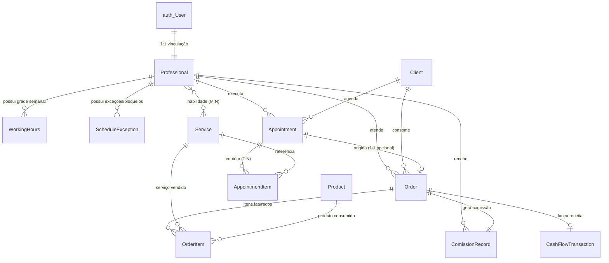

# 💈 BarberPro — Backend Engine & Architectural Specification

> Sistema corporativo de alta concorrência para gestão operacional e agendamento em barbearias, implementado em **Python 3.14** e **Django 6** com **Django REST Framework**. Projetado sob princípios de Domain-Driven Design (DDD), isolamento de camada de serviços (*Service Layer Pattern*), controle de concorrência com bloqueio pessimista (*Pessimistic Locking* via `SELECT FOR UPDATE`) e conformidade estrita com **ACID** e **PEP 8**.

---

## 🏛️ 1. Arquitetura do Sistema & Separação de Domínios

O sistema foi decomposto em **5 bounded contexts** modulares, evitando acoplamento cíclico e garantindo separação rigorosa entre modelagem relacional (*persistence model*) e orquestração de regras de negócio (*service layer*):

```
barber/
├── catalog/          # Subdomínio de Catálogo: Serviços, Produtos e Precificação
├── professionals/    # Subdomínio de RH: Profissionais, Grades Semanais e Feriados
├── clients/          # Subdomínio de CRM: Clientes, Validações Sanitárias e Restrições
├── scheduling/       # Subdomínio Core: Motor de Slots Livres e Agendamento Atômico
├── financial/        # Subdomínio Financeiro: Comandas (PDV), Estoque, Comissões e Caixa
├── setup/            # Núcleo de Configuração e Roteamento
└── manage.py
```

### Princípios Arquiteturais Aplicados:
* **Service Layer Pattern**: Operações que envolvem múltiplos modelos, transações atômicas e efeitos colaterais (ex: `scheduling.services.create_booking` e `Order.close_order`) são isoladas dos models e serializers, permitindo reutilização via CLI, Admin, REST API e Webhooks.
* **Fail-Fast & Encapsulated Validation**: Regras invariantes de domínio são validadas em `clean()` e invocadas deterministicamente no `save()` de cada modelo.
* **Imutabilidade de Snapshots Históricos**: Variações futuras no preço de serviços/produtos não afetam agendamentos passados ou comandas fechadas através de congelamento de valores (*historical price freezing*).

---

## 🗄️ 2. Diagrama Entidade-Relacionamento (DER)



---

## ⚡ 3. Motor de Disponibilidade Temporal (`scheduling/services.py`)

O algoritmo de busca de horários livres (`get_available_slots`) modela o tempo contínuo em **intervalos discretos quantizados** no espaço $\mathbb{Z}_{\ge 0}$ em minutos ($[0, 1439]$):

$$\text{minutes}(t) = t_{\text{hour}} \times 60 + t_{\text{minute}}$$

### Formalização Matemática do Algoritmo:

1. **Universo de Janelas de Trabalho ($W$)**:
   Composto pelo turno base da grade semanal ($W_{\text{regular}}$) obtido via `WorkingHours.day_of_week == target_date.isoweekday()`, somado aos turnos extras do dia ($W_{\text{extra}}$):
   $$W = \bigcup_{i} [w_{i,\text{start}}, w_{i,\text{end}})$$

2. **Conjunto de Intervalos Bloqueados ($B$)**:
   Agregação de intervalos proibidos compostos por:
   * Intervalo de almoço/pausa: $[b_{\text{break\_start}}, b_{\text{break\_end}})$.
   * Bloqueios pontuais do barbeiro ou feriados parciais: $[e_{\text{start}}, e_{\text{end}})$.
   * Agendamentos ativos ($A_{\text{active}}$) acrescidos do buffer de assepsia da bancada ($\Delta_{\text{buffer}}$):
     $$[a_{\text{start}}, a_{\text{end}} + \Delta_{\text{buffer}})$$
   * Janela passada (se a data for o dia atual, onde $t_{\text{now}}$ recebe tolerância mínima de $\Delta_{\text{lead}} = 15\text{ min}$):
     $$[0, t_{\text{now}} + \Delta_{\text{lead}})$$

3. **Verificação de Não-Conflito (*Interval Overlap Theorem*)**:
   Para cada slot candidato iniciado em $k \in W$, com término em $k + D$ (onde $D$ é a duração total dos serviços acumulados):
   
   $$\text{Conflito}(k, D, B) \iff \exists [b_{\text{start}}, b_{\text{end}}) \in B \quad \text{tal que} \quad (k < b_{\text{end}}) \land (k + D > b_{\text{start}})$$

   Se $\text{Conflito} = \text{Falso}$ e $k + D \le w_{\text{end}}$, o slot $k$ é adicionado ao conjunto de saída.

4. **Complexidade Algorítmica**:
   * O fatiamento roda em $O\left(\frac{|W|}{\text{step}} \cdot |B|\right)$, onde $|B| \ll 100$ e $|W| \le 1440$, garantindo tempo de resposta **$< 5\text{ms}$** sem necessidade de cache intermediário.

---

## 🔒 4. Concorrência, Atomicidade & ACID (`SELECT FOR UPDATE`)

### Problema de Concorrência Crítica (*Double Booking*)
Em ambientes web com alta concorrência, duas requisições paralelas para o mesmo barbeiro no mesmo horário passam simultaneamente por uma validação ingênua de leitura (`filter(...).exists()`), gerando sobreposição em banco (*Race Condition*).

### Solução Arquitetural no BarberPro:
O método `scheduling.services.create_booking` opera com **bloqueio pessimista a nível de linha (*Pessimistic Row-Level Lock*)**:

```python
@transaction.atomic
def create_booking(..., professional: Professional, ...):
    # 1. Adquire bloqueio exclusivo de linha (FOR UPDATE) no RDBMS
    professional = (
        Professional.objects.select_for_update().get(pk=professional.pk)
    )

    # 2. Reavalia a disponibilidade com o estado mais recente do banco
    available_slots = get_available_slots(professional, target_date, total_duration)
    if start_time.strftime("%H:%M") not in available_slots:
        raise ValidationError("Este horário acabou de ser preenchido.")

    # 3. Persistência transacional atômica (Appointment + AppointmentItems)
    appointment = Appointment(...)
    appointment.full_clean()
    appointment.save()
    AppointmentItem.objects.bulk_create(...)
    return appointment
```

* Durante a janela de transação, qualquer outra requisição concorrente para o mesmo profissional aguarda na fila do banco de dados até a liberação do lock (`COMMIT`/`ROLLBACK`).

---

## 💳 5. Engenharia Financeira & Máquina de Estados da Comanda

O fechamento de uma comanda (`Order.close_order`) executa uma cascata transacional de 4 estágios com garantia de consistência entre estoque, contabilidade e CRM:

```
[ Comanda Aberta (OPEN) ]
           │
           ▼ (close_order via SELECT FOR UPDATE)
┌───────────────────────────────────────────────────────────┐
│ 1. Trava concorrente da Ordem e dos Produtos envolvidos   │
│ 2. Validação e Débito de Estoque (Product.stock_quantity) │
│ 3. Transição de Estado: Order.status = PAID               │
│ 4. Conclusão do Appointment: status = COMPLETED          │
│ 5. Incremento de Fidelidade: Client.total_visits += 1     │
│ 6. Emissão de ComissionRecord (Serviços + Produtos + Tip) │
│ 7. Lançamento Contábil no Caixa (CashFlowTransaction)     │
└───────────────────────────────────────────────────────────┘
```

### Prevenção de Furo de Caixa e Descontos Negativos
A liquidação utiliza álgebra decimal exata (`decimal.Decimal`), eliminando erros de arredondamento de ponto flutuante (*IEEE 754*). A gorjeta (*Tip*) é segregada do abatimento de descontos promocionais:

$$\text{Total} = \max(0, \text{Subtotal} - \text{Desconto}) + \text{Gorjeta}$$

---

## 🛡️ 6. Políticas de Integridade Referencial & Otimizações de Banco

| Relação | Política `on_delete` | Justificativa de Engenharia |
| :--- | :--- | :--- |
| `Order.professional` | `models.PROTECT` | Impede deleção de profissional com histórico fiscal ou auditoria em aberto. |
| `Order.appointment` | `models.SET_NULL` | Permite venda avulsa no balcão e preserva histórico da venda caso o agendamento seja removido. |
| `Appointment.client` | `models.PROTECT` | Protege histórico de atendimento e fidelidade contra perda acidental de cliente. |
| `AppointmentItem.appointment` | `models.CASCADE` | Dependência ontológica estrita: o item compõe exclusivamente aquele agendamento. |
| `ComissionRecord.order` | `models.CASCADE` | Relação 1:1 biunívoca entre a venda faturada e o extrato de comissão gerado. |

### Indexação Composta Estratégica:
* `Appointment.Meta.indexes`: `models.Index(fields=['professional', 'date', 'status'])`
  * Reduz o scan de tabela para index range scan de custo $O(\log N)$ na leitura de agenda diária.
* Chaves primárias com `UUIDv4`: Imunes a ataques de enumeração horizontal (*Insecure Direct Object Reference - IDOR*) e prontas para replicação distribuída / multi-tenant.

---

## 🇧🇷 7. Sistema de Feriados Dinâmicos (`ScheduleException`)

Integração nativa com a biblioteca internacional `holidays` especializada na legislação brasileira:
* **Detecção Automática**: Durante a chamada de `clean()`, se uma exceção é categorizada como `HOLIDAY`, o sistema automaticamente define `is_all_day = True` e preenche o nome oficial do feriado (ex: *"Tiradentes"*, *"Dia da Consciência Negra"*).
* **Carga em Lote Anual**:
  ```python
  ScheduleException.populate_national_holidays(year=2026, state='SP')
  ```
  Gera todas as instâncias no banco de dados com tratamento de idempotência (`professional=None` para indisponibilidade geral da barbearia).

---

## 🔐 8. Especificação da API RESTful, RBAC & Autenticação JWT

A camada HTTP é segregada em três superfícies de acesso com controle de permissões baseado em papéis (*Role-Based Access Control* via `IsBarberShopStaff` e `IsOwnerOrReadOnly`):

### 8.1 Autenticação & Sessão (`/api/auth/`)
| Método | Endpoint | Permissão | Descrição |
| :--- | :--- | :--- | :--- |
| `POST` | `/api/auth/login/` | `AllowAny` | Emite par de tokens JWT (`access` de 8h + `refresh` de 7d com rotação). |
| `POST` | `/api/auth/refresh/` | `AllowAny` | Renova o token de acesso via `refresh` token. |
| `GET` | `/api/auth/me/` | `IsBarberShopStaff` | Retorna contexto do usuário, papel (`ADMIN` ou `PROFESSIONAL`) e perfil vinculado. |

### 8.2 Superfície Pública — Vitrine & Self-Booking (`/api/public/`)
| Método | Endpoint | Descrição |
| :--- | :--- | :--- |
| `GET` | `/api/public/services/` | Catálogo de serviços ativos com `effective_price` calculado. |
| `GET` | `/api/public/professionals/` | Lista de barbeiros ativos e serviços habilitados. |
| `GET` | `/api/public/availability/` | Cálculo dinâmico de slots (`?date=YYYY-MM-DD&service_ids=u1,u2&professional_id=u3`). |
| `POST` | `/api/public/bookings/` | Criação atômica de agendamento com `select_for_update()`. |
| `GET` | `/api/public/bookings/<cancel_token>/` | Consulta pública segura via token criptográfico anti-IDOR. |
| `POST` | `/api/public/bookings/<cancel_token>/cancel/` | Cancelamento autônomo pelo cliente (se `PENDING` ou `CONFIRMED`). |

### 8.3 Superfície Administrativa & Operacional (`/api/admin/`)
| Recurso | Endpoint Base | Actions Customizadas & Regras de Escopo |
| :--- | :--- | :--- |
| **Serviços** | `/api/admin/services/` | CRUD completo (escrita restrita a `is_staff`, leitura liberada à equipe). |
| **Produtos** | `/api/admin/products/` | CRUD + filtro `?is_low_stock=true` via expressão `F('min_stock_alert')`. |
| **Clientes** | `/api/admin/clients/` | Busca unificada `?search=`, filtro `?is_blocked=` e `POST /{id}/toggle-block/`. |
| **Profissionais** | `/api/admin/professionals/` | CRUD + `PUT /{id}/working-hours/` para atualização atômica da grade semanal. |
| **Exceções** | `/api/admin/schedule-exceptions/` | Gestão de folgas, férias, feriados e turnos extras. |
| **Agendamentos** | `/api/admin/appointments/` | Isolamento de agenda por barbeiro, `POST /{id}/open-order/` e `POST /{id}/mark-no-show/`. |
| **Comandas (PDV)** | `/api/admin/orders/` | `POST /{id}/add-item/`, `DELETE /{id}/remove-item/{item_id}/` e `POST /{id}/close/`. |
| **Comissões** | `/api/admin/commissions/` | Extrato por profissional + `POST /{id}/mark-paid/` (gera saída no caixa). |
| **Fluxo de Caixa** | `/api/admin/cashflow/` | Filtros por período/tipo/categoria + `GET /summary/` para indicadores de dashboard. |

---

## 🧪 9. Qualidade de Código (PEP 8) & Testes Automatizados

* **Controle Estrito de Linhas**: 100% dos arquivos formatados dentro do limite de **79 caracteres** por linha (`0` violações).
* **Tipagem Estática**: Type hints aplicados em funções críticas (`time`, `date`, `Decimal`, `list[str]`).
* **Suíte de Testes (`manage.py test`)**: Cobertura automatizada de cálculo de slots, bloqueio de feriados, prevenção de *double-booking*, trava de clientes bloqueados, contabilização de `no-show`, baixa de estoque, cálculo de comissão com gorjeta e consolidação de fluxo de caixa.

---

## 🚀 10. Guia de Inicialização Técnica & Docker

### Execução Local (Virtualenv)
```bash
# 1. Clonagem e Isolamento
git clone https://github.com/omlobao/barber-pro.git
cd barber-pro
python3 -m venv venv
source venv/bin/activate

# 2. Resolução de Dependências e Migrações
pip install -r requirements.txt
python manage.py migrate

# 3. Execução da Suíte de Testes e Verificação de Integridade
python manage.py check
python manage.py test

# 4. Inicialização do Servidor
python manage.py createsuperuser
python manage.py runserver
```

### Execução via Docker
```bash
docker build -t barber-pro -f dockerfile .
docker run -p 9000:9000 barber-pro
```

---

## 📜 Licença

Distribuído sob a licença **MIT**. Consulte `LICENSE` para detalhes adicionais.

Autor: **[Matheus Lobão](https://github.com/omlobao)** — *Engenharia de Software Full Stack & Arquitetura Back-End.*
